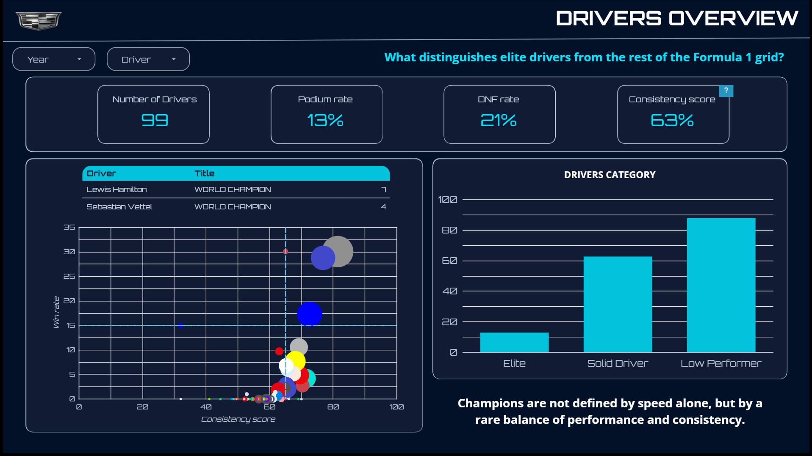
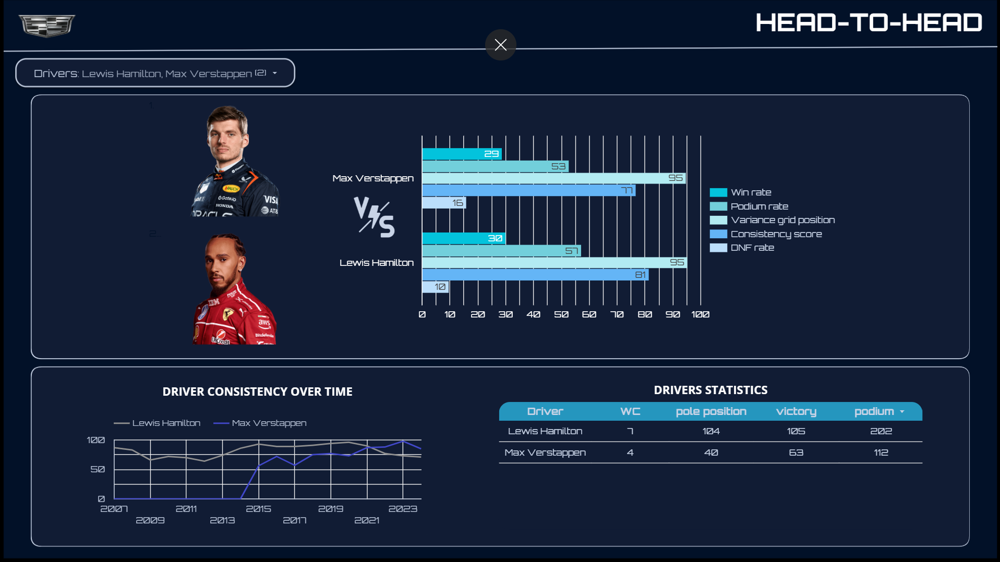
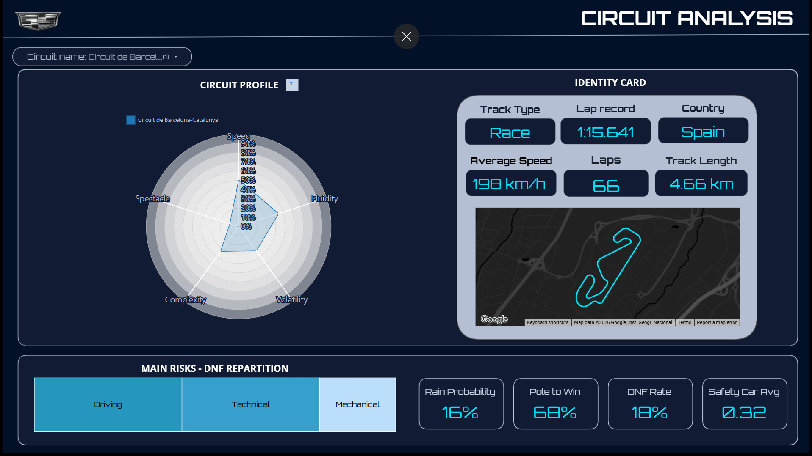

# 🏎️ F1 Performance Analytics (2006–2024) — Cadillac F1 Case Study

Projet de fin de formation Data Analytics (**Le Wagon**, 2026) réalisé en équipe de 4 personnes et présenté devant un jury et un public de 60 personnes.

## 🔗 Accès rapide aux livrables
* 📊 **[Dashboard Interactif Looker Studio](https://datastudio.google.com/s/pBIzWJL2CU8)** *(filtres dynamiques par saison, pilote et circuit)*
* 📄 **[Présentation complète du projet (PDF)](docs/F1_Project.pdf)**
* 🗄️ **[Requêtes SQL BigQuery](sql/)**

## 🎯 Objectif du projet
Analyser **19 saisons de Formule 1 (2006–2024)** afin d'identifier les leviers clés permettant de transformer la régularité en titres mondiaux, et formuler une recommandation data-driven sur le duo de pilotes idéal pour l'arrivée de l'écurie **Cadillac F1**.

## 🛠️ Stack Technique & Architecture
* **Collecte (Web Scraping) :** Python
* **Nettoyage & Préparation :** Python (Pandas)
* **Data Warehouse & Modélisation :** SQL sur Google BigQuery ([voir les requêtes](sql/))
  * `constructors_infos_since_2006.sql` : agrégation des performances et points par écurie
  * `nb_constructeurs_per_season.sql` : évolution de la grille par saison
  * `conversion_pole_podium.sql` : taux de conversion des pole positions et croisements pilotes
  * `avg_speed_per_circuit.sql` : calcul de la vitesse moyenne par tracé
* **Data Visualization :** Tableaux de bord interactifs sur Looker Studio

## 📈 Principaux Insights
* **3 ères de domination :** Ère compétitive (2006–2013), Ère Mercedes (2014–2021) et Ère Verstappen / Red Bull (2022–2024).
* **Fiabilité constructeurs :** Un taux de fiabilité supérieur à **90 %** est indispensable pour jouer le championnat.
* **Recommandation pilotes :** Choix du duo **Sergio Pérez & Valtteri Bottas** pour privilégier l'expérience, la régularité et un faible taux d'abandon.

## 🖼️ Aperçu du Dashboard Interactif

**Vue d'ensemble pilotes & filtrage par saison**

**Comparateur dynamique Head-to-Head**

**Analyse par circuit**

## 👥 Équipe
Projet réalisé par Esther, Merryl, Simon, et moi-même.
